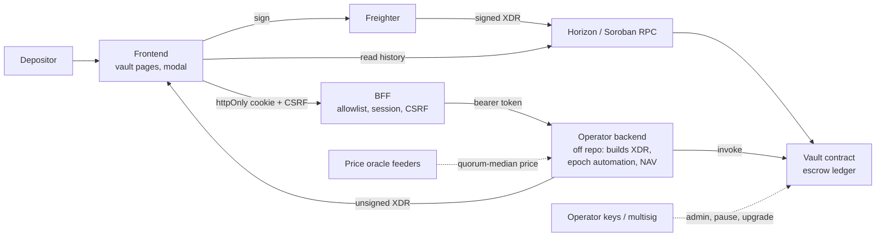

# Vault Audit Preparation Package — Zenith

Issue [#204](https://github.com/Zenith-options/frontend/issues/204) · Companion to [`vault-threat-model.md`](vault-threat-model.md)

**Readiness: not audit-ready.** The vault contracts, the operator backend, the
indexer and the fuzz harness are not in this repository, and no live testnet
deployment exists. Sections 4 and 5 state each gap. A checked item below means
it was verified against this repo at the commit shown.

Baseline commit for this package: `21925df` (`main`, merge of #166).

---

## 1. Scope

The engagement covers the Phase 2 vault stack. Each component's location and
pinned commit is listed below. Where the commit is **not pinned**, the audit
cannot start until it is.

| Component | Repository | Commit | Pinned? | Key paths |
|---|---|---|---|---|
| Vault contract (escrow ledger) | `Zenith-options/contracts` (`vault`) | not in this repo | **No** | Registry entry `src/lib/soroban/registry.ts` has `deployments: {}` and `sourceCommit` empty |
| Multisig contract | `Zenith-options/contracts` (`multisig`) | not in this repo | **No** | As above |
| Price oracle contract | `Zenith-options/contracts` (`price_oracle`) | not in this repo | **No** | As above |
| Operator backend and indexer | not in this repo | not in this repo | **No** | Endpoints used: `/api/v1/vaults*`, `/api/v1/onchain/build-deposit`, `/api/v1/onchain/build-withdraw` |
| Frontend vault client | this repo | `21925df` | Yes (this commit) | `src/lib/api/vault.ts`, `src/lib/api/vaults.ts`, `src/components/DepositWithdrawModal.tsx`, `src/app/[locale]/vaults/` |
| BFF | this repo | `21925df` | Yes (this commit) | `src/app/api/bff/`, `src/lib/bff/` (`allowlist.ts`, `csrf.ts`, `session.ts`, `handlers.ts`, `constants.ts`) |
| Clear-signing | this repo | `21925df` | Yes (this commit) | `src/lib/soroban/` (`decode.ts`, `intent.ts`, `tx.ts`, `pipeline.ts`, `contracts/spec.ts`) |
| Feature flag | this repo | `21925df` | Yes (this commit) | `src/lib/flags/` (`registry.ts`, `resolve.ts`) |

**Out of scope for this package:** the audit engagement contract, and any
remediation (filed as follow-up issues `F-xx`, see the threat model §5).

**Known broken at `21925df`:** `src/lib/api/client.ts` is a zero-byte file, but
27 modules import from it, including the vault client (`F-00`). The vault
signing path cannot run at this commit. Audit must start after `F-00` lands,
and the audit commit must be recorded here.

---

## 2. Architecture

### Data flow: deposit (current, as shipped)

1. The user enters an amount in `DepositWithdrawModal.tsx` and confirms.
2. `depositToVault` (`src/lib/api/vault.ts`) calls `POST /api/v1/onchain/build-deposit` through the BFF.
3. The BFF checks the origin, the CSRF token, and the allowlist (`required` auth), then attaches the bearer token server-side.
4. The backend returns `{ xdr }`.
5. **The frontend passes the XDR to Freighter without decoding it.** This is `F-01`.
6. The signed XDR is posted to Horizon (`submitTransactionXdr` in `src/lib/api/stellar.ts`).
7. The returned hash is shown. History is read from Horizon contract events.

### Data flow: governance (reference, clear-signed)

`submit.ts` → `executeContractCall` (`pipeline.ts`) → build, simulate, assemble → decode → `verifyIntent` → `ConfirmDialog` → sign → `assertSignedMatchesReviewed` → submit. The vault flow should match this path.

---

## 3. Invariants

### 3.1 Frontend invariants (verified in this repo)

`docs/security/invariants.md` lists SEC-001 to SEC-023, covering signing
challenges, address poisoning, token storage, per-wallet isolation, and
headers/SRI. They are run as `src/test/security/invariants.test.ts`.
**None of them covers the vault flows.**

### 3.2 Vault invariants (claimed, not verified here)

The registry descriptions state these properties. They are the candidate
list for the contracts-side fuzz harness, which is **not in this repo**. Each
one needs a harness check and a stable ID before the audit.

| Candidate ID | Contract | Property (from the registry description) | Status |
|---|---|---|---|
| VINV-01 (proposed) | vault | A withdrawal under tag `t` never draws down more than was deposited under tag `t`. | Claimed. Harness not in this repo. |
| VINV-02 (proposed) | vault | Deposits and withdrawals are scoped to a caller-defined tag. Tags do not share balance. | Claimed. |
| VINV-03 (proposed) | multisig | `is_approved(action_id)` is true only once the threshold of distinct signers has approved. | Claimed. |
| VINV-04 (proposed) | price_oracle | The aggregate is the median of fresh reports, and it is produced only when a minimum quorum of fresh reports exists. No single feeder sets it alone. | Claimed. |
| VINV-05 (proposed) | frontend | A deposit or withdraw transaction is signed only after `verifyIntent` returns no mismatches and the signed hash equals the reviewed hash. | **Not true for vault flows at `21925df`** (`F-01`). Required before audit. |
| VINV-06 (proposed) | frontend | A withdrawal is never submitted with an amount above the backend's free collateral. | UX check only. Backend and contract must enforce (`F-02`). |

The only fuzz-style tests in this repo are `src/lib/validation/__tests__/parseNumber.fuzz.test.ts` and `src/components/__tests__/xss.corpus.test.tsx`. Neither covers the vault.

---

## 4. Deployment and upgrade runbook

Nothing here has run against a live network yet. Each step is taken from the
code it cites, and the open gaps are marked.

### 4.1 Deploy a contract (contracts repo)

1. Build the WASM from a tagged commit in `Zenith-options/contracts`.
2. Record the SHA-256 of the WASM, as 64 lowercase hex characters. This is the `wasmHash` the live check compares against (`src/lib/soroban/registry.ts`, `ContractDeployment.wasmHash`).
3. Record the source commit in `sourceCommit` and the audit report URL in `auditReportUrl` once one exists.
4. Set `upgradeable` to match whether `upgrade(new_wasm_hash)` is exposed.
5. Fill in the `deployments` block for the network in the registry. This is the only place the registry is populated; the rest of the page and `/contracts.json` read from it.

### 4.2 Point the frontend at the deployment

Set the vault contract ID for the target network. **Three different names are
in use at `21925df`, and they do not agree** (`F-10`):

| Name | Where read | Used by |
|---|---|---|
| `NEXT_PUBLIC_CONTRACT_VAULT_TESTNET` / `..._MAINNET` | `src/env.ts`, `src/env-schema.cjs` | Env validation |
| `NEXT_PUBLIC_TESTNET_VAULT_CONTRACT_ID` / `NEXT_PUBLIC_MAINNET_VAULT_CONTRACT_ID` | `src/lib/env/networks.ts` (`contracts.optionsVault`) | Network config |
| `NEXT_PUBLIC_VAULT_CONTRACT_ID` | `src/lib/api/vault.ts` | Vault client. Throws "not configured" when unset. |

Until `F-10` lands, set **all three** to the same value. Setting only one
leaves the other readers with no value, so parts of the app disagree about
which contract is deployed.

Set `NEXT_PUBLIC_HORIZON_URL` explicitly for the target network. It defaults
to `https://horizon-testnet.stellar.org`, including on mainnet builds.

Set `BFF_SESSION_SECRET` (at least 32 characters) from a secret manager. It is
required in production (`src/lib/bff/session.ts`). Do not commit it.

Keep `NEXT_PUBLIC_VAULTS` and the `vaults` flag **off** until canary. The flag
defaults to `false` (`src/lib/flags/registry.ts`). The query override is
development-only (`src/lib/flags/resolve.ts`).

### 4.3 Upgrade a contract

1. Build and hash the new WASM, as in §4.1.
2. Confirm `upgradeable` is `true` and that the upgrade runs behind multisig (`F-07`). Do not proceed until `F-07` is verified.
3. Call `upgrade(new_wasm_hash)` through the multisig.
4. Append `{ version, wasmHash, deployedAt, note }` to `upgradeHistory`, newest last. Update `wasmHash`, `version` and `sourceCommit` to the new release.
5. Confirm the live check passes on the contracts page. A mismatch means the on-chain WASM is not the audited release.

### 4.4 Roll back

There is no tested rollback path in this repo. Rolling back a contract means
an upgrade to a previous audited WASM, which needs §4.3 with the old hash. The
frontend can be rolled back by turning `vaults` off through the flag. Turning
the flag off does not move funds, and users keep on-chain positions.

---

## 5. Live testnet deployment

**Status: not done.** The registry states that the protocol has no public
deployment yet, and `deployments` is empty for every contract. The auditors
need a testnet deployment they can exercise. That needs:

- A deployed vault, multisig and price oracle on testnet, with their contract IDs recorded in the registry.
- A recorded WASM hash and source commit for each.
- A funded test account for the auditors, and a runbook for exercising deposit, withdraw, epoch transitions and pause.

Creating these requires access to the contracts repo and the testnet deploy
credentials, which are not in this checkout. Once they exist, record the
contract IDs under `deployments.testnet` in `src/lib/soroban/registry.ts`
and link them here.

---

## 6. Dependency and supply-chain review

Checked against this repo at `21925df`:

- **No vault-specific packages were added.** Vault code uses `@stellar/freighter-api` and `@stellar/stellar-sdk`, which are already in `package.json`.
- **The `@stellar/freighter-api` range is `^2.0.0`** (`package.json`). `SECURITY.md` requires exact pins for new dependencies. This predates the vault work, but it is the wallet dependency that signs vault transactions, so it should be pinned before audit.
- **`security/audit-exceptions.json` has no entries.** `osv-scanner.toml` has only commented examples. No vulnerability is currently waived.
- **CI gates in `.github/workflows/security.yml`:** lockfile-lint, the lockfile-only-change flag, `npm audit` through `scripts/security/audit-gate.mjs`, OSV-Scanner, and the license gate through `scripts/security/check-licenses.mjs`. These run on the repo's own lockfile and cover the vault client's dependencies.
- **Not run for this document.** I did not run `npm audit`, OSV-Scanner or the license gate locally. Their results on `21925df` need to be recorded before the audit starts.

---

## 7. Test-evidence package

| Evidence | Status |
|---|---|
| Frontend unit and invariant tests (`invariants.test.ts`, `bff.test.ts`, clear-signing tests) | Exist in repo. Not run for this document, per the issue instructions. |
| Vault client tests | **None.** No test covers `vault.ts` or the vault page. |
| Contract unit, fuzz and property tests | Not in this repo. |
| Local Soroban or testnet proof-of-concept for the top threats (VT-01, VT-02) | **Not done.** Required by the issue. Needs `F-00` and `F-01` first. |
| Reproduction fixtures for each high-severity threat | **Not done.** |

---

## 8. Remaining work before the audit

1. Land `F-00` (restore `client.ts`) and confirm the vault path builds.
2. Land `F-01` (clear-signing for vault flows) and `F-10` (one env name).
3. Pin the contracts commit and the WASM hashes in the registry (§1, §4.1).
4. Write the contracts-side invariant harness and assign IDs to VINV-01 to VINV-04 (§3.2).
5. Stand up the testnet deployment (§5).
6. Run the dependency gates locally and record the output (§6).
7. Write the vault proof-of-concept tests for VT-01 and VT-02 and file each as a regression fixture (§7).
8. File each `F-xx` as a GitHub issue and link it in the threat model (§5 there).
