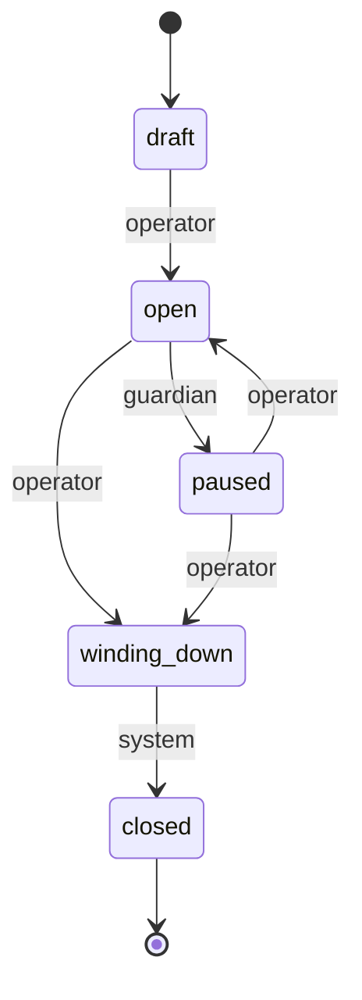

# Vault Lifecycle State Machine

Every vault is in exactly one status at a time. The status decides which user actions are allowed. The same definition is mirrored in `src/lib/api/vaults.ts` (`VAULT_STATUSES`, `VAULT_TRANSITIONS`, `VAULT_STATUS_POLICY`). Contracts, the registry backend, and the REST payloads must use the same names and rules.

`status` is the vault lifecycle. It is separate from the epoch `phase` (`deposit` / `active` / `settlement`), which tracks the option cycle inside an open vault.

## States

| Status         | Meaning                                                   | Deposit | Withdraw |
| -------------- | --------------------------------------------------------- | ------- | -------- |
| `draft`        | Created, not yet accepting funds.                         | No      | No       |
| `open`         | Accepting deposits and withdrawal requests.               | Yes     | Yes      |
| `paused`       | Frozen by the guardian or operator. No funds move.        | No      | No       |
| `winding_down` | Closed to new deposits. Holders can exit.                 | No      | Yes      |
| `closed`       | Terminal. All positions settled.                          | No      | No       |

Any status not listed above is treated as read-only by the frontend (`vaultStatusPolicy` returns no permitted actions). A status string from a newer backend must never fall through to the actionable branch.

## Transitions

| From           | To             | Actor    | Notes                                                                 |
| -------------- | -------------- | -------- | --------------------------------------------------------------------- |
| `draft`        | `open`         | operator | Launch. Governance-gated (out of scope for this document).            |
| `open`         | `paused`       | guardian | Emergency freeze. Can be triggered without a governance vote.         |
| `open`         | `winding_down` | operator | Governance-gated.                                                     |
| `paused`       | `open`         | operator | Unfreeze. Governance-gated.                                           |
| `paused`       | `winding_down` | operator | Governance-gated.                                                     |
| `winding_down` | `closed`       | system   | Automatic. Allowed only when no redemption tickets are outstanding.   |

Any other edge is illegal and is rejected. Re-applying the current status is idempotent: it changes nothing and writes no history entry.

## Diagram

## Edge cases

- **Closing with outstanding redemption tickets.** `winding_down → closed` is rejected while any redemption ticket is unsettled. The vault stays in `winding_down` so holders can still withdraw.
- **Winding down with positions still open at expiry.** `winding_down` keeps the vault open for settlement. The system transition to `closed` runs only after every position is settled.
- **Paused mid-epoch.** `paused` freezes deposits and withdrawals for the rest of the epoch. The epoch is not settled early. Unpausing resumes the current epoch without re-running the deposit window.
- **Idempotent re-application.** Applying a transition that is already recorded returns the current status with `changed: false`. Backends must not append a duplicate history entry.

## Enforcement by layer

- **Contracts:** deposit and withdraw entry points reject calls unless `permittedActions` for the stored status includes the action. Transitions check the edge and the actor.
- **Registry backend:** persists the current status and an append-only history of `{ from, to, actor, timestamp }`.
- **REST payloads:** `status` is a string from the set above. Clients must handle unknown values.
- **Frontend:** `/vaults` shows the status badge. `/vaults/[id]` shows only the actions the status permits, and shows a read-only notice otherwise. Handlers re-check the policy before submitting.
